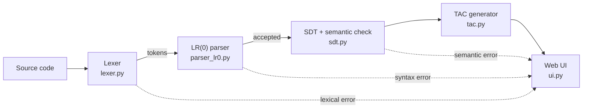

# CompyFI LR(0) — Educational Compiler in Python


An educational compiler built from scratch in Python that walks through every phase of compilation: **lexical analysis**, **LR(0) bottom-up parsing**, **syntax-directed translation**, **semantic validation** and **three-address code (TAC) generation**. A local web interface shows each phase step by step.

> Team project for the **Compilers** course at the **Faculty of Engineering, UNAM** (Group 5, Team 08 · Semester 2026-II).

---

## Table of Contents

- [Features](#features)
- [Compilation Pipeline](#compilation-pipeline)
- [Grammar](#grammar)
- [Getting Started](#getting-started)
- [Built-in Examples](#built-in-examples)
- [Repository Structure](#repository-structure)
- [Documentation](#documentation)
- [Team](#team)

---

## Features

- **Lexer** that turns source code into ordered `(type, lexeme)` tokens and reports unrecognized symbols.
- **LR(0) parser** that builds the canonical collection of items, the state transitions and the **ACTION/GOTO table**, then runs a shift-reduce parse with a full step-by-step trace.
- **Syntax-directed translation (SDT)** with basic semantic validation and a **symbol table**.
- **TAC generation** with backpatching for `while` and `if` structures.
- **Three-level error handling:** lexical, syntactic and semantic.
- **Web interface** with tabbed panels for tokens, grammar, states, transitions, ACTION/GOTO table, parse trace, symbol table, SDT rules and TAC.
- Built only with the **Python standard library** (`http.server`), so there is nothing to install.

## Compilation Pipeline



## Grammar

A reduced block-based language with `while`, `if`, simple statements and conditions:

```text
0. P' -> P
1. P  -> B
2. B  -> { W }
3. B  -> { }
4. W  -> W S
5. W  -> S
6. S  -> while ( C ) B
7. S  -> if ( C ) B
8. S  -> i ;
9. C  -> i < i
```

`P` = program · `B` = block · `W` = statement list · `S` = statement · `C` = condition · `i` = identifier

Example of a valid program:

```text
{
    i;
    while ( i < i ) {
        i;
    }
    if ( i < i ) { }
}
```

## Getting Started

**Requirements:** Python 3.10 or later. No external packages are needed.

```bash
git clone https://github.com/hugo12341234/compyfi-lr0-compiler.git
cd "compyfi-lr0-compiler/México/UNAM/FI/Compilers/G5/08"
python src/main.py
```

Then open <http://127.0.0.1:8000/index.html> in your browser. Press `Ctrl+C` in the terminal to stop the server.

> The web interface is in Spanish.

## Built-in Examples

The compiler view includes ready-to-run examples, so no test files are needed:

| Example | Expected result |
|---|---|
| Block with `while` and `if` | Accepted: full parse, semantic check and TAC |
| Empty block | Accepted through `B -> { }` (no TAC) |
| Missing semicolon | Syntax error |
| Incomplete condition | Syntax error |
| Missing closing brace | Syntax error |

You can also type your own program in the editor and analyze it.

## Repository Structure

The project lives in the folder structure required by the course (`México/UNAM/FI/Compilers/G5/08`):

```text
México/UNAM/FI/Compilers/G5/08/
├── src/
│   ├── main.py          # Entry point: local HTTP server and routes
│   ├── ui.py            # HTML views and the full compilation flow
│   ├── lexer.py         # Lexical analysis
│   ├── parser_lr0.py    # LR(0) items, ACTION/GOTO table and shift-reduce parser
│   ├── sdt.py           # Semantic validation and symbol table
│   ├── tac.py           # Three-address code generation
│   ├── index.html       # Static entry page
│   └── multimedia/      # Interface assets
├── docs/
│   ├── 08-Compilers-FinalProject.pdf
│   └── 08-Compilers-Presentation.pdf
└── .gitignore
```

## Documentation

- [Final report (PDF)](México/UNAM/FI/Compilers/G5/08/docs/08-Compilers-FinalProject.pdf): theoretical background, grammar, LR(0) item collection, ACTION/GOTO table, parse traces, SDT rules, TAC generation, architecture and test cases.
- [Presentation (PDF)](México/UNAM/FI/Compilers/G5/08/docs/08-Compilers-Presentation.pdf)

## Team

Developed by **Team 08, Group 5** — Compilers course, Computer Engineering, Faculty of Engineering, UNAM (2026-II).

- **Hugo Emmanuel Chacón Jaral** — [@hugo12341234](https://github.com/hugo12341234)
- and four teammates of Team 08

Original repository: [str-mdz/unam.fi.compilers.g5.08](https://github.com/str-mdz/unam.fi.compilers.g5.08)
